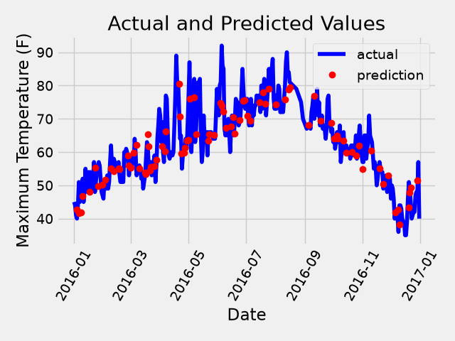
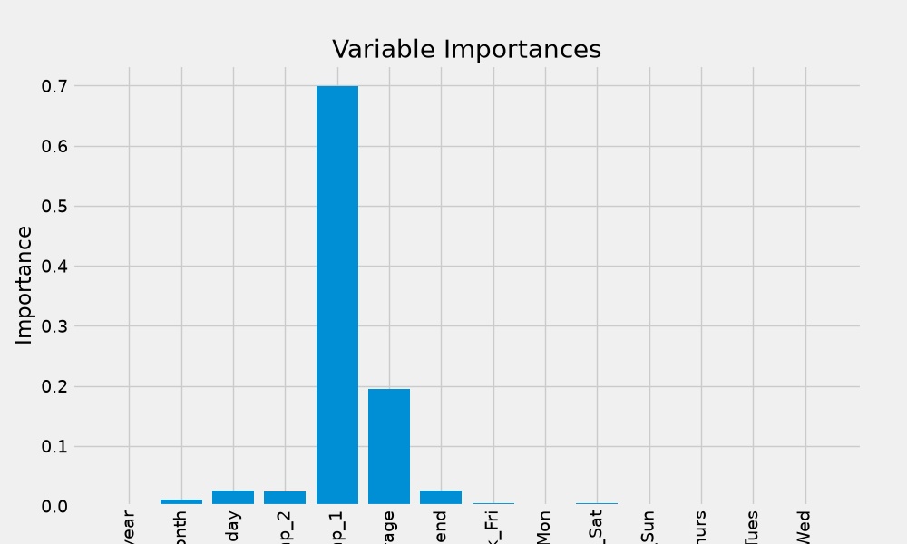
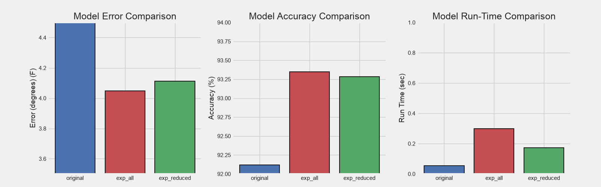

# Weather Prediction with Random Forests

A Python machine learning project that predicts daily maximum temperatures using Random Forest regression.

This project explores how additional weather features, feature selection, and hyperparameter tuning affect prediction performance and computation time.

## Main Tasks

- Explore temperature trends and seasonal patterns.
- Preprocess data and encode categorical features.
- Train Random Forest regression models.
- Analyze feature importance and select useful features.
- Compare prediction errors and training/prediction times.
- Tune model parameters using RandomizedSearchCV and GridSearchCV.

## Project Files

- `weather.py`: Basic modeling, feature importance analysis, and prediction visualization.
- `weather_updated.py`: Extended weather features, feature selection, runtime comparisons, and hyperparameter tuning.
- `data/temps.csv`: Original dataset containing 348 observations.
- `data/temps_extended.csv`: Extended dataset containing 2,191 observations.
- `figure/`: Saved plots from the experiments.
- `tree.png`: A saved decision tree visualization.

## Features

The models use information such as previous temperatures, historical average temperatures, and calendar features. The extended dataset also includes previous-day wind speed, precipitation, and snow depth.

The prediction target is the daily maximum temperature, measured in degrees Fahrenheit.

## Installation

```bash
python -m pip install numpy pandas matplotlib seaborn scikit-learn pydot
```

Graphviz is additionally required if you enable the decision tree image export code.

## Usage

Run the scripts from the project root directory.

For the basic experiment:

```bash
python weather.py
```

For the extended experiments and hyperparameter tuning:

```bash
python weather_updated.py
```

The extended script includes several parameter searches and can take longer to finish. Some plotting calls are commented out, and the scripts do not automatically save figures.

## Example Visualizations

### Actual vs. Predicted Temperatures



### Feature Importance



### Model Comparison



## Evaluation

Models are evaluated using mean absolute error (MAE), mean absolute percentage error (MAPE), and execution time.

The value labeled "Accuracy" in the scripts and plots is calculated as `100 - MAPE`; it is not classification accuracy.

This is a learning project using random train/test splits. Evaluating future forecasting performance would require a chronological split.